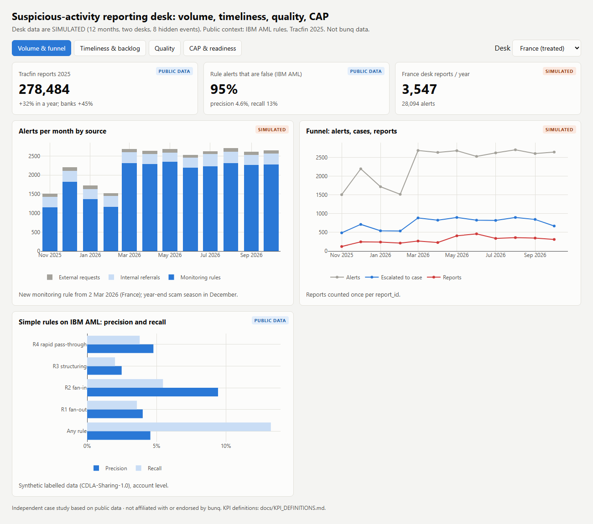

# bunq: making suspicious-activity reporting to France's FIU fast, complete and measurable

**Question.** How can a France reporting team track the **volume, timeliness and quality** of its suspicious-activity reports,
**fix its data problems** and **prepare for the EU AMLR (10 July 2027)**, from numbers it can trust?

Independent case study based on public data · not affiliated with or endorsed by bunq. Facts about bunq are **as stated by bunq**
in its 2025 annual report. Everything about the reporting desk itself is **SIMULATED**: it is not bunq's data, process or performance.

| Deliverable | Link |
|---|---|
| 8-page report (PDF) | [bunq_suspicious_activity_reporting_case_study.pdf](https://github.com/albt-france/bunq-suspicious-activity-reporting-case-study/blob/main/report/bunq_suspicious_activity_reporting_case_study.pdf) |
| Interactive dashboard | [Open the dashboard](https://albt-france.github.io/bunq-suspicious-activity-reporting-case-study/dashboard/reporting_dashboard.html) |



## Four key results
1. **Volume is not the problem; quality is.** Tracfin received **278,484** reports in 2025 (+32%), 93% from the financial sector, banks +45%; its stated challenge is to improve the quality of what it receives as fast as the volume. *(PUBLIC DATA)*
2. **Simple rules are a noisy input.** Four transparent rules on IBM's labelled synthetic AML data flag laundering accounts at **3.7×** the base rate (precision 4.6% vs 1.2%), yet **95%** of alerts are false and recall is **13%**. *(PUBLIC DATA, synthetic)*
3. **A metric that lied.** In the simulated desk, the tool's time-to-file fell **40%** (11.0 → 6.7 days) in September because its clock moved from the alert to case opening; recomputed from the alert it was flat (11.0 days). Not credited. *(SIMULATED)*
4. **The real gain, measured properly.** The August pre-fill cut analyst effort per case by **23%** (difference-in-differences vs a control desk, 95% CI −27% to −18%; true simulated effect −25%), while a schema change had silently cut completeness at draft to **83%**. *(SIMULATED)*

## What is in the repository
```
src/        fetch_public.py, download_ibm.py, extract_ibm_aml.py, simulate.py, run_sql.py, findings.py,
            prefill_report.py, build_excel.py, build_dashboard.py, build_pdf.py, charts.py, polite.py
sql/        01_ibm_profile · 02_alert_rules · 03_reporting_funnel · 04_quality · 05_cap_tracking · 06_did_prefill
tests/      test_prefill.py (missing field, duplicate, after-midnight deadline, clock start)
data/       processed/ (public extracts and aggregates), simulated/ (desk tables), SOURCES.md
docs/       REPORTING_PROCEDURE, KPI_DEFINITIONS, GAP_ANALYSIS, DATA_ISSUES_LOG, GLOSSARY
output/     prefill/ example drafts (JSON + Markdown) and the missing-fields log
```

## Methods
- **Public context**: bunq annual report 2025 (pages cited), Tracfin 2025 figures and guidance pages, ECB payment-fraud statistics (France vs Netherlands, unit checked), the AMLR text on EUR-Lex (articles checked in the text).
- **From transactions to alerts**: IBM AML HI-Small (5.08 M synthetic transactions) loaded with DuckDB; four rules (fan-out, fan-in, structuring, rapid pass-through) evaluated at account level: precision, recall, alerts per 1,000 accounts, threshold curve, typology coverage. Only aggregates are published.
- **Simulated desk**: 12 months (Nov 2025 – Oct 2026), France (treated) and Benelux (control), seed 42, eight hidden events (new rule, schema change, retry duplicates, clock-definition change, pre-fill, December spike, CAP slippage, UTC timestamps), each found from the data in the notebook.
- **KPIs**: one definition each (`docs/KPI_DEFINITIONS.md`): clock from the alert, Paris dates, one report per `report_id`.
- **Causal estimate**: difference-in-differences on log effort, 95% interval from a bootstrap over weeks.
- **Automation**: `src/prefill_report.py` builds a structured draft and **blocks** it when a required field is missing; tests cover the rules.
- AI-assisted workflow: I used Claude, mainly to write scripts faster. I drove the project: I defined the questions, chose and validated the data sources, made the analytical decisions and checked every result.

## How to re-run
```
pip install -r requirements.txt
python src/fetch_public.py        # ECB, EUR-Lex, job page; bunq report read from data/raw if saved by hand
python src/download_ibm.py        # IBM AML HI-Small (475 MB, not published)
python src/extract_ibm_aml.py
python src/simulate.py
python src/run_sql.py
python src/findings.py
python src/prefill_report.py
pytest
jupyter nbconvert --to notebook --execute --inplace notebooks/analysis.ipynb
python src/build_excel.py
python src/build_dashboard.py
python src/build_pdf.py
```
No API key is needed. Without the raw IBM file, `run_sql.py` keeps the published IBM aggregates and re-runs the desk queries.
The PDF needs Microsoft Edge or Chrome (headless printing).

## Sources and licences
See [data/SOURCES.md](data/SOURCES.md). IBM AML: **CDLA-Sharing-1.0** (synthetic data, AMLSim). ECB: statistics re-use terms. EUR-Lex: © European Union, re-use authorised. Tracfin pages and bunq documents: quoted briefly with links and reading dates (18 Nov 2026). Collection was polite: robots.txt respected (the bunq report host disallows scripts, so it was saved from a browser), at least 3 s between requests, neutral User-Agent, no account, no form.

## Limits
- No real bunq data: the desk is simulated to show how the methods behave. Volumes are plausible for an online bank, not bunq's.
- IBM data is synthetic; real laundering is rarer, more varied and adaptive. Rule thresholds were fixed before looking at the labels, not tuned.
- Legal points come only from the sources read (Tracfin pages, AMLR text). French code articles are cited as stated by Tracfin. **Not legal advice; to be confirmed with Compliance / Legal.**
- The 14-day target is an internal target of the simulated desk, not a legal deadline (Tracfin: report before executing the transaction, or without delay in the listed exceptions).
- The Looker files are illustrative and not validated in a Looker instance.
- Confidentiality: a suspicious-activity report must never be disclosed to the customer or third parties; this repository contains identifiers only (`case_000123`, `user_04567`), no names.
